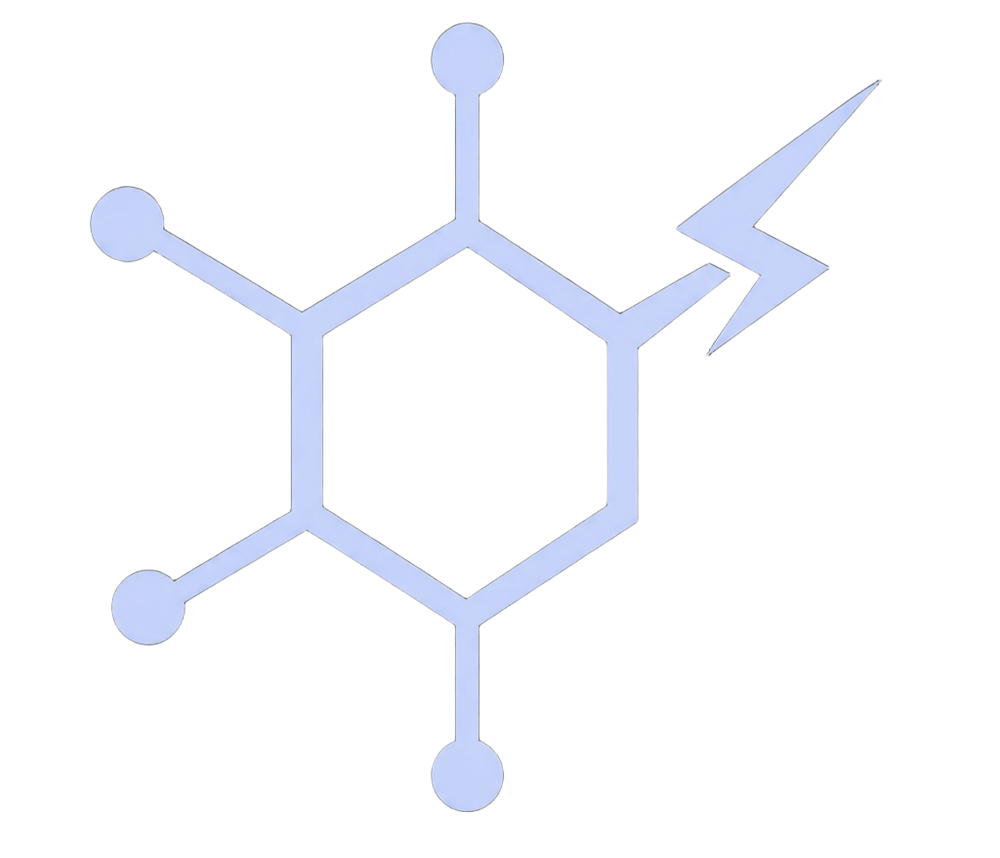

<h1 align="center">  DOPAMINE 💊​ <font size="3">v0.2.0</font></h1>


<font size="3">**⚠️​Warning⚠️**: This version (0.2.0) is a work in progress and may not be fully functional.</font>

Dopamine is a modern Desktop shell for Quickshell. It is designed to be easy to customize and extend, while providing a clean and modern interface. 

## Features

- Modern, minimalistic design
- Easy to customize (colors, fonts and sizes in one place)
- Workspace indicators for Hyprland, including **Lua-config** dispatchers
- Clock with date
- Volume control via PipeWire (`pactl`)
- System indicators: CPU, RAM and battery (UPower)
- Application launcher with fuzzy search
- Based on the Quickshell framework

## Quickstart

Requirements: [Quickshell](https://quickshell.org), PipeWire (`pactl`), UPower and Hyprland.

To get started with Dopamine, simply copy the contents of this directory to your Quickshell configuration directory and start it:

```sh
qs -c dopamine
```

## Launcher

The application launcher can be opened from the bar button or through IPC (useful to bind it to a keybind):

```sh
qs -c dopamine ipc call launcher toggle
```

## Repository Structure

```
dopamine/
  ├── shell.qml                  # Entry point
  ├── Config/
  │   ├── Colors.qml             # Colors, fonts, sizes — everything centralized
  │   └── qmldir
  ├── Services/
  │   ├── Audio.qml              # Volume / PipeWire (pactl)
  │   ├── Clock.qml              # Date and time
  │   ├── Hyprland.qml           # Hyprland workspaces / windows
  │   ├── SystemInfo.qml         # CPU, RAM, battery
  │   ├── Launcher.qml           # Launcher state + IPC handler
  │   └── qmldir
  ├── Widgets/
  │   ├── Launcher.qml           # Application launcher overlay
  │   └── qmldir
  └── Modules/
      └── bar/
          ├── Bar.qml            # Main bar (top bar)
          ├── LeftSection.qml    # Launcher button + workspaces
          ├── CenterSection.qml  # Clock
          ├── RightSection.qml   # CPU/RAM/battery, volume, time
          └── qmldir
```

## Changelog

### v0.2.0

- **Added** system info service (`SystemInfo.qml`): CPU, RAM and battery (UPower).
- **Added** CPU, RAM and battery indicators to the right section of the bar.
- **Added** application launcher (`Widgets/Launcher.qml`) with search, icons and IPC control.
- **Added** launcher button to the left section.
- **Fixed** compatibility with Quickshell 0.3.x (`Variants` requires `required property var modelData`; `PanelWindow` uses `implicitHeight`).
- **Fixed** workspace handling on Hyprland running in **Lua mode** (dispatchers now use `hl.dsp.focus(...)`).

### v0.1.0

- Initial release: color configuration, audio and clock services, and the main bar with application buttons.

## License

MIT License by Alan Sastre.<br>
Read the [LICENSE](./LICENSE) file for more information.<br>
<br>

# Español

Dopamine es un shell de escritorio moderno para Quickshell. Está diseñado para ser fácil de personalizar y extender, mientras proporciona una interfaz limpia y moderna.<br>
<br>

## Características

- Diseño moderno y minimalista
- Fácil de personalizar (colores, fuentes y tamaños en un solo lugar)
- Indicadores de workspaces para Hyprland, incluyendo dispatchers en modo **Lua**
- Reloj con fecha
- Control de volumen vía PipeWire (`pactl`)
- Indicadores de sistema: CPU, RAM y batería (UPower)
- Launcher de aplicaciones con búsqueda
- Basado en el framework de Quickshell

## Inicio rápido

Requisitos: [Quickshell](https://quickshell.org), PipeWire (`pactl`), UPower y Hyprland.

Para comenzar con Dopamine, simplemente copia el contenido de este directorio a tu directorio de configuración de Quickshell e inícialo:

```sh
qs -c dopamine
```

## Launcher

El launcher de aplicaciones se puede abrir desde el botón de la barra o por IPC (útil para atarlo a un atajo):

```sh
qs -c dopamine ipc call launcher toggle
```

## Estructura del repositorio

```
dopamine/
  ├── shell.qml                  # Entrada principal
  ├── Config/
  │   ├── Colors.qml             # Colores, fuentes, tamaños — todo centralizado
  │   └── qmldir
  ├── Services/
  │   ├── Audio.qml              # Volumen / PipeWire (pactl)
  │   ├── Clock.qml              # Fecha y hora
  │   ├── Hyprland.qml           # Workspaces / ventanas de Hyprland
  │   ├── SystemInfo.qml         # CPU, RAM, batería
  │   ├── Launcher.qml           # Estado del launcher + handler IPC
  │   └── qmldir
  ├── Widgets/
  │   ├── Launcher.qml           # Overlay del launcher de aplicaciones
  │   └── qmldir
  └── Modules/
      └── bar/
          ├── Bar.qml            # Barra principal (top bar)
          ├── LeftSection.qml    # Botón launcher + workspaces
          ├── CenterSection.qml  # Reloj
          ├── RightSection.qml   # CPU/RAM/batería, volumen, hora
          └── qmldir
```

## Changelog

### v0.2.0

- **Añadido** servicio de información del sistema (`SystemInfo.qml`): CPU, RAM y batería (UPower).
- **Añadidos** indicadores de CPU, RAM y batería en la sección derecha de la barra.
- **Añadido** launcher de aplicaciones (`Widgets/Launcher.qml`) con búsqueda, iconos y control por IPC.
- **Añadido** botón del launcher en la sección izquierda.
- **Corregida** compatibilidad con Quickshell 0.3.x (`Variants` requiere `required property var modelData`; `PanelWindow` usa `implicitHeight`).
- **Corregido** manejo de workspaces en Hyprland en **modo Lua** (los dispatchers ahora usan `hl.dsp.focus(...)`).

### v0.1.0

- Versión inicial: configuración de colores, servicios de audio y reloj, y la barra principal con los botones de aplicaciones.

## Licencia

Licencia MIT por Alan Sastre.<br>
Lee el archivo [LICENSE](./LICENSE) para más información.
